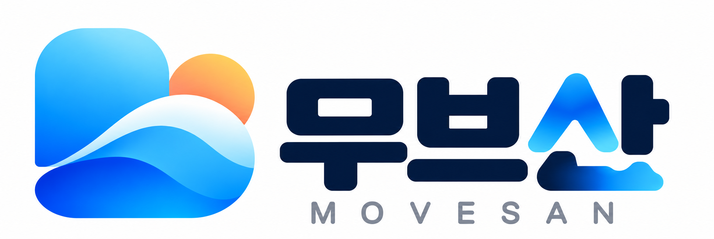
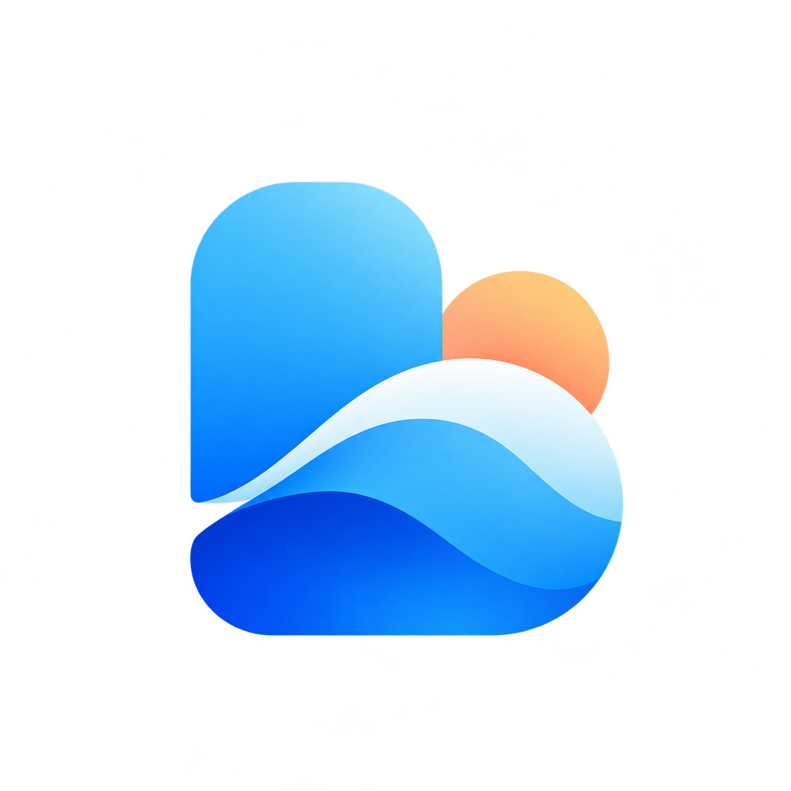
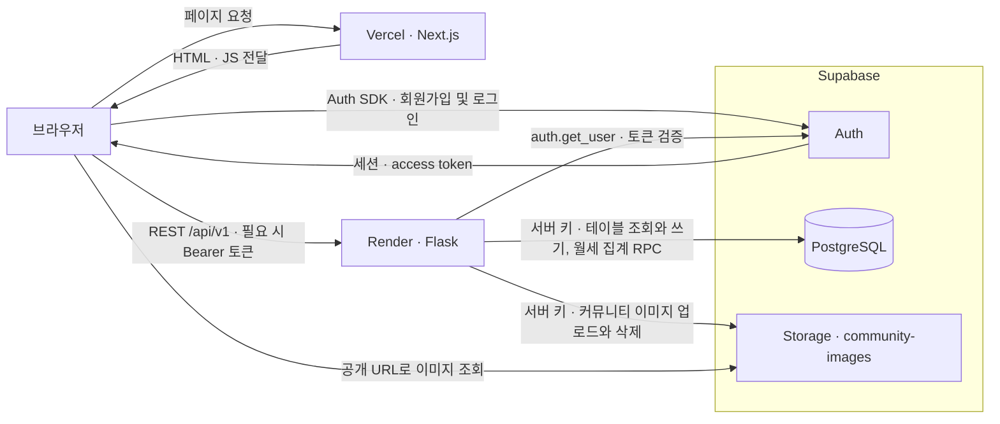
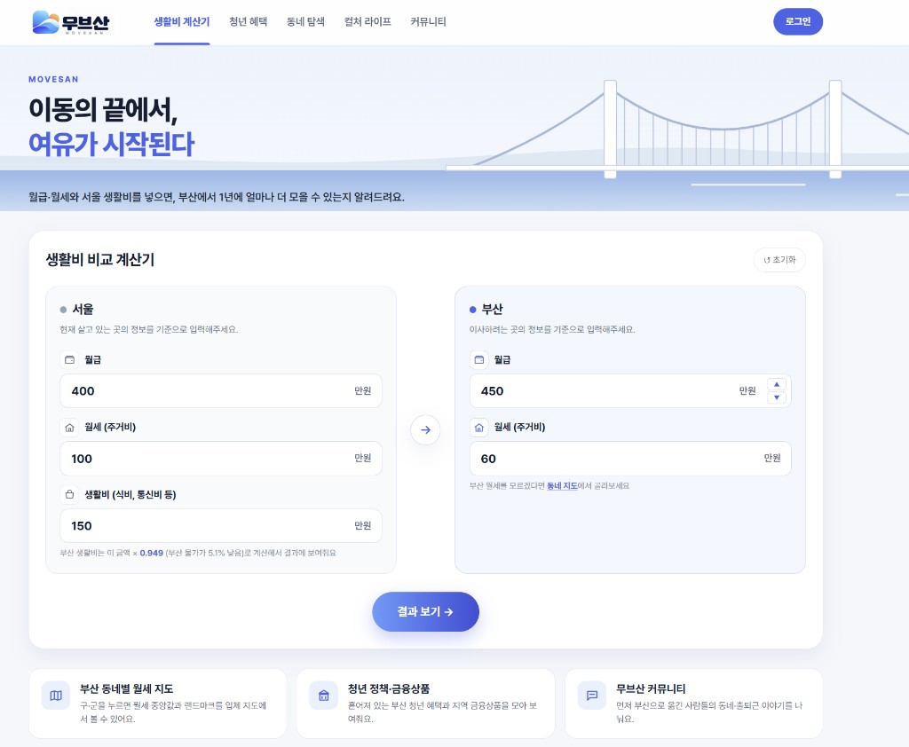
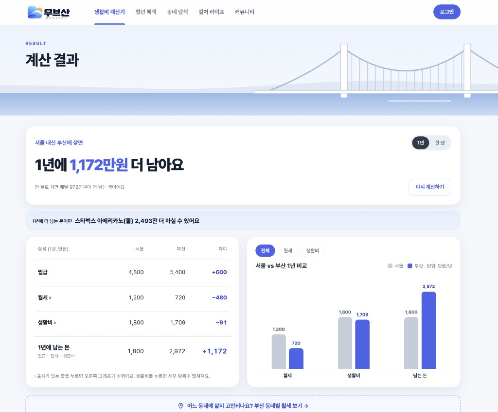
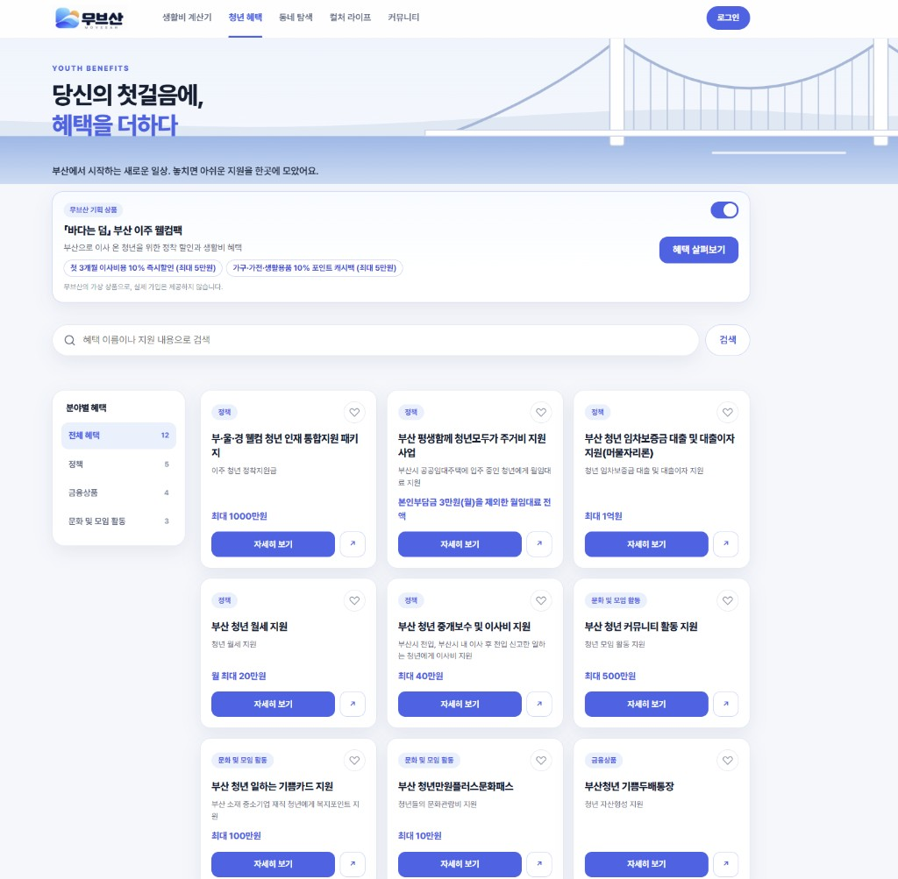
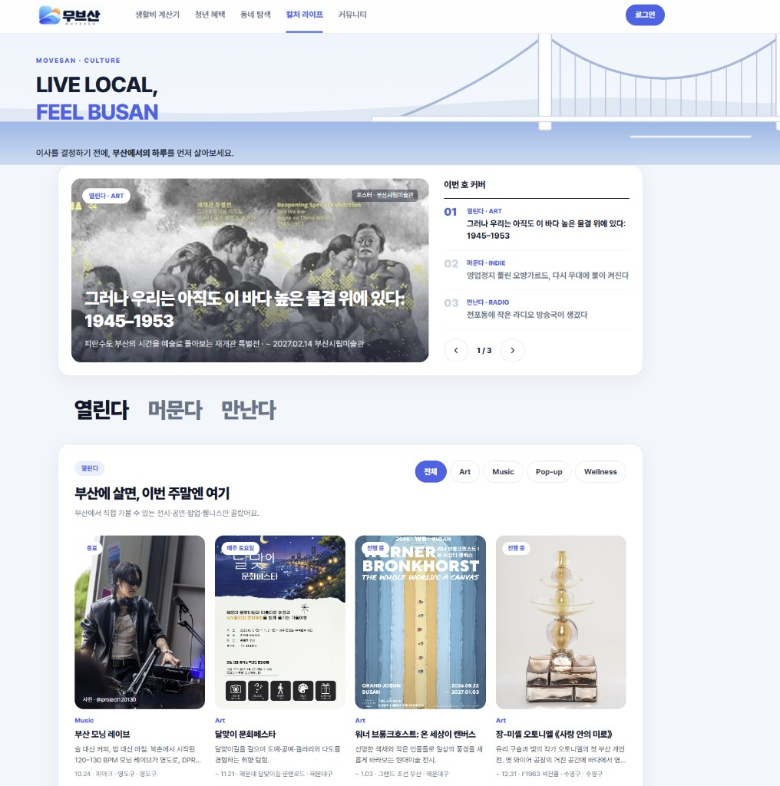
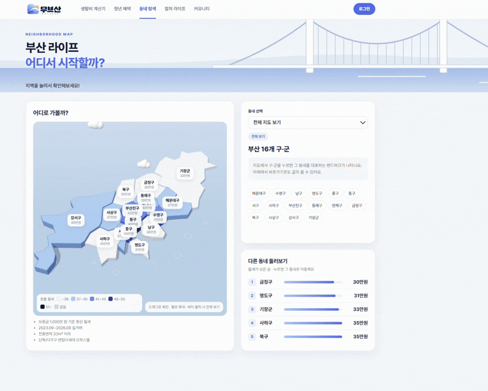

<p align="center">
  
  
</p>

# 무브산 (MoveSan)

##  프로젝트 소개

무브산은 서울에서 부산으로 이직·이주를 고민하는 청년들의 이주 판단을 돕는 웹서비스입니다. 자신의 월급·월세·생활비를 기준으로 두 도시에서 한 달과 1년에 각각 얼마가 남는지 비교하고, 부산 구·군별 월세와 청년 혜택, 컬처 라이프, 커뮤니티를 한곳에서 확인할 수 있습니다.

**개발 기간:** 2026.10.19 – 2026.11.04

## 목차

- [기획 배경 및 설문조사 결과](#-기획-배경-및-설문조사-결과)
- [주요 기능](#-주요-기능)
- [시스템 구성도](#-시스템-구성도)
- [기술 스택](#tech-stack)
- [기술적 문제 해결](#technical-challenges)
- [ 프로젝트 구조](#project-structure)
- [ 실행 방법](#-실행-방법)
- [ 주요 화면](#-주요-화면)
- [ 향후 확장 계획](#-향후-확장-계획)

## 기획 배경 및 설문조사 결과

### 1. 서비스의 필요성

서울과 부산은 월급과 월세, 물가가 다릅니다. 이주를 고민할 때는 동네별 주거비와 정착 정보를 찾는 것부터, 그 정보를 내 월급과 지출에 대입해 이주 전후를 비교하는 것까지 여러 단계를 거쳐야 합니다.

### 2. 설문조사를 통한 문제 검증

서비스 기획 과정에서 이주 준비 시 겪는 어려움과 필요한 정보를 파악하기 위해 **서울–부산(지방) 근무지 이동 및 이주 준비 경험 설문조사**를 진행했습니다.

- **조사 기간:** 2026.10.19. ~ 2026.10.21.
- **조사 대상:** 설문 응답자 20명
- **조사 방식:** 온라인 설문조사

#### 주요 설문 결과

| 조사 항목 | 설문 결과 |
|---|---|
| 주거비 정보 탐색 경험 | **75%** (15명) |
| 필요한 정보가 여러 곳에 분산되어 탐색이 어려움 | **65%** (13명) |
| 자신의 상황에 맞는 정보인지 판단하기 어려움 | **50%** (10명) |
| 이주 전후 수입·지출을 항목별로 계산한 경험 | **10%** (2명) |
| 서울과 부산의 경제적 차이 비교를 서비스 이용 목적으로 선택 | **50%** (10명) |
| 지원 정책 및 금융상품 확인을 서비스 이용 목적으로 선택 | **40%** (8명) |

> 복수 선택 문항의 비율은 전체 응답자 20명을 기준으로 산출했습니다.

#### 설문 결과에서 도출한 문제점

설문 결과를 통해 다음 세 가지 문제에 주목했습니다.

1. **분산된 정보** — 응답자의 65%가 필요한 정보가 여러 곳에 흩어져 찾기 어렵다고 답했습니다. 주거비와 지원 정책을 알아보려면 여러 사이트를 오가야 합니다.
2. **개인별 비교의 어려움** — 50%가 자신의 상황에 맞는 정보인지 판단하기 어렵다고 답했습니다. 같은 지역 정보도 급여와 주거 조건에 따라 다르게 적용됩니다.
3. **경제적 변화 예측의 어려움** — 이주 전후 수입과 지출을 항목별로 계산해 본 응답자는 10%였습니다. 비용 정보를 찾은 뒤에도 실제로 남는 금액을 가늠하는 과정이 남습니다.

#### 무브산의 해결 방향

구·군별 월세 지도와 청년 정책·금융 정보를 한곳에 모으고, 지도에서 고른 월세를 비교 계산기에 바로 넣을 수 있도록 기획했습니다. 사용자가 자신의 급여와 지출을 기준으로 두 도시의 월·연간 잔액을 비교하고, 문화·모임과 먼저 이주한 사람들의 이야기도 함께 살펴볼 수 있도록 구성했습니다.

##  주요 기능

### 1. 서울·부산 생활비 비교

서울과 부산의 월급·월세, 서울 생활비를 입력하면 두 도시에서 남는 금액을 계산합니다. 부산 생활비는 서울 생활비에 `0.949`를 곱해 추정합니다. 연간 차이는 반올림 전 월 차이에 12를 곱해 계산하고, 결과는 표와 그래프로 확인할 수 있습니다. 월급·월세·생활비 중 차이가 가장 큰 항목도 API가 반환합니다. 계산 결과는 데이터베이스에 저장하지 않습니다.

### 2. 구·군별 월세 지도

부산 16개 구·군을 입체 지도(`/map`)에서 고르면 월세 중앙값과 랜드마크를 확인할 수 있습니다. WebGL을 쓸 수 없거나 3D 화면을 그리지 못하면 2D 지도(`/map-2d`)로 이동할 수 있는 링크를 표시합니다. 지도에서 고른 월세는 생활비 계산의 부산 월세로 넣을 수 있습니다.

월세는 보증금 1,000만 원 환산 기준이고, 기간은 2023-09~2026-08, 전용면적 33㎡ 이하, 주택 유형은 단독·다가구, 연립·다세대, 오피스텔입니다.

### 3. 청년 혜택·금융상품

- **청년 정책** — 부산 청년 정책을 카테고리와 키워드로 조회하고 공식 링크를 확인할 수 있습니다.
- **금융상품** — 혜택 화면에서 프론트엔드 정적 데이터로 구성한 가상 금융상품인 ‘부산 이주 웰컴팩’의 기획 내용을 안내합니다. 금융상품 목록·상세 API는 `501`을 반환합니다.
- **정책 즐겨찾기** — 관심 정책은 로그인 없이 현재 브라우저의 `localStorage`에 저장할 수 있습니다. 계정별 동기화에 사용할 등록·해제 API는 `501`을 반환합니다.

### 4. 컬처 라이프

부산에서의 생활을 세 갈래로 나눠 Flask API에서 조회합니다.

- **열린다** — 전시, 음악, 팝업, 웰니스 행사
- **머문다** — 책방, 온천·목욕, 극장 같은 장소와 프로그램·소식
- **만난다** — 부산에서 음악과 공간을 만들어가는 모임·커뮤니티 이야기

### 5. 커뮤니티

먼저 부산으로 옮긴 사람의 동네·출퇴근 이야기를 글과 댓글로 나눕니다. 목록과 상세 조회는 비회원도 이용할 수 있습니다. 로그인하면 글·댓글 작성, 이미지 업로드, 본인 글·댓글 삭제를 할 수 있습니다. 게시글 편집은 미구현입니다.

### 6. 회원

 이메일 회원가입·로그인·로그아웃은 브라우저에서 Supabase Auth로 처리합니다. 이메일 확인이 필요한 가입에는 안내 화면을 표시합니다. Flask는 회원 전용 요청과 토큰이 첨부된 커뮤니티 조회에서 Supabase Auth가 확인한 사용자 ID를 사용합니다. 생활비 계산과 공개 조회는 로그인 없이 사용할 수 있습니다.


## 시스템 구성도



브라우저에서 실행되는 Next.js 클라이언트가 `NEXT_PUBLIC_API_URL`의 Flask API를 직접 호출합니다. Flask는 로컬 개발 주소와 `FRONTEND_ORIGIN`으로 지정한 운영 프론트 출처 한 곳을 CORS에 허용합니다. 인증 세션은 브라우저의 Supabase Auth SDK가 유지하고, Flask는 보호된 요청의 토큰을 Supabase Auth에 확인한 뒤 사용자 ID를 얻습니다. 공개 커뮤니티 조회에도 토큰을 보내면 작성자 여부를 응답에 포함합니다.

서비스 API의 명세는 [`busan_api_spec_v1.4.yaml`](busan_api_spec_v1.4.yaml)에 있습니다. 서비스 응답은 `status`, `message`, `result`를 기본으로 하고, 계산기와 지도 API의 금액 단위는 만원입니다. 명세에는 금융상품과 계정별 즐겨찾기처럼 구현 예정인 경로도 포함되어 있습니다.

월세 집계 함수와 커뮤니티 SQL은 [`BE/sql/`](BE/sql/)에 있습니다. 운영 도메인은 배포 대시보드에서 관리하는 값이며, 저장소 설정과 Git 이력에서는 실제 Vercel·Render 주소를 확인할 수 없습니다.

<a name="tech-stack"></a>

## 기술 스택

### Frontend

| 분류 | 기술 스택 |
|---|---|
| 프레임워크 | Next.js `^15.3.0`, React `^19.1.0` |
| 언어 | JavaScript, 일부 TypeScript (챗봇) |
| 스타일 | CSS Modules, `globals.css` |
| 상태 관리 | Zustand `^5.0.16` |
| 인증 | Supabase Auth (`@supabase/ssr` `^0.12.7`, `@supabase/supabase-js` `^2.118.0`) |
| 3D 지도 | Three.js `^0.170.0`, React Three Fiber `^9.8.2`, Drei `^10.7.9` |
| 글꼴 | CSS 글꼴 스택에서 Pretendard 계열 우선 지정 |

프론트엔드 버전 범위는 `package.json` 기준입니다. `package-lock.json`에는 Next.js `15.5.28`, React `19.3.1`이 고정되어 있습니다.

### Backend

| 분류 | 기술 스택 |
|---|---|
| 프레임워크 | Flask 3.1.3 |
| 언어 | Python |
| 검증 | Pydantic 2.14.1 |
| 데이터베이스 클라이언트 | supabase-py 2.33.0 (`supabase`) |
| 인증 | Supabase Auth `get_user`로 access token 검증 |
| CORS | flask-cors 6.0.5 |
| 서버 | 개발 `python app.py`, 운영용 Gunicorn 26.2.0 |
| 테스트 | pytest 8.4.2 |
| API 문서 | OpenAPI 3.0.3 (`busan_api_spec_v1.4.yaml`) |

### Database

| 분류 | 용도 |
|---|---|
| Supabase PostgreSQL | 정책, 컬처, 주거 통계, 게시글·댓글, 이미지 메타데이터, 프로필 |
| Supabase Auth | 회원가입, 로그인, 세션 |
| Supabase Storage | 커뮤니티 이미지 |

<a name="technical-challenges"></a>

## 기술적 문제 해결

### 1. 공개 API의 로딩과 일시적 오류 처리

- **문제 상황** — Render 무료 인스턴스는 유휴 상태에서 첫 요청에 응답하기까지 시간이 걸릴 수 있습니다. 공개 데이터를 불러오는 동안에는 로딩과 실패를 구분해야 했고, 커뮤니티 글 목록에서는 Supabase 연결이 일시적으로 끊기는 경우도 있었습니다. [Render 무료 인스턴스 문서](https://render.com/docs/free)
- **해결 과정** — 컬처 라이프는 응답을 기다리는 동안 카드 스켈레톤을 표시하고, 실패하면 다시 시도할 수 있게 했습니다. 주거·청년 정책·컬처 공개 조회의 성공 응답을 브라우저 메모리에 2~5분간 보관하고, 같은 키로 진행 중인 요청은 공유합니다. 커뮤니티 글 목록은 Flask에서 Supabase 조회 중 `RemoteProtocolError`가 발생한 경우에 한해 새 쿼리로 한 번 더 조회하고, 두 번째도 실패하면 `503`을 반환합니다. [공개 조회 캐시](frontend/src/lib/publicCache.js) · [컬처 상태 UI](frontend/src/components/culture/CultureStatus.js) · [글 목록 재시도 테스트](BE/tests/test_community.py)
- **결과** — 유효한 캐시가 있으면 탭을 다시 열 때 같은 데이터를 재요청하지 않습니다. 요청에 실패하면 사용자가 빈 목록과 오류를 구분하고 화면에서 재시도할 수 있습니다.

### 2. 부산 구·군별 월세 지도를 2D에서 3D로 확장

- **문제 상황** — SVG 지도에서 16개 구·군의 위치와 월세를 확인할 수 있었고, 지도를 확장하면서 구·군의 월세 차이와 랜드마크를 한 화면에서 함께 살펴볼 수 있도록 했습니다.
- **해결 과정** — Three.js와 React Three Fiber로 구·군 경계 좌표를 입체 메시로 만들고, 월세 중앙값을 색과 높이에 반영했습니다. 구·군을 선택하면 해당 랜드마크 모델을 불러옵니다. 브라우저에서 WebGL 지원을 확인하고, 미지원이나 3D 렌더링 오류 시 2D 지도 링크를 표시합니다. 두 화면은 같은 월세·순위 API를 사용합니다. [2D 지도](frontend/src/components/map/BusanMap.js) · [3D 구·군 렌더링](frontend/src/components/map3d/District.js) · [WebGL 대체 화면](frontend/src/components/map3d/Map3DCanvas.js)
- **결과** — 3D 화면에서는 구·군별 월세와 랜드마크를 함께 탐색할 수 있고, WebGL을 사용할 수 없는 환경에서도 2D 화면으로 구·군별 월세와 순위를 확인할 수 있습니다.

### 3. 분리 개발한 프론트엔드와 백엔드의 API 경로 통일

- **문제 상황** — 프론트엔드와 Flask를 분리해 개발하면서 청년 정책과 컬처 조회 경로가 다른 서비스 API와 달랐습니다. 공개 조회와 회원 요청에 필요한 인증 방식도 요청별로 맞춰야 했습니다.
- **해결 과정** — 청년 정책·컬처 라우트를 프론트엔드가 호출하는 `/api/v1`으로 맞추고 OpenAPI 명세와 Flask 테스트의 경로를 함께 수정했습니다. 공개 목록은 공통 응답의 `result`에서 데이터를 읽고, 글 작성 같은 보호된 요청에는 Supabase 세션의 Bearer 토큰을 붙여 Flask에서 검증합니다. [경로 통일 커밋](https://github.com/kkimhayeon/move_san/commit/326b227cf47c37b87259424a20f7725a028649b2) · [OpenAPI 명세](busan_api_spec_v1.4.yaml) · [프론트 API 클라이언트](frontend/src/api/client.js)
- **결과** — 구현된 정책·컬처 공개 목록에서 프론트엔드 호출, Flask 라우트, 명세와 테스트가 같은 경로를 사용하고, 회원 요청은 서버가 확인한 사용자 ID로 처리합니다.

<a name="project-structure"></a>

##  프로젝트 구조

```
move_san/
├── frontend/                 # Next.js 웹
│   ├── public/               # 로고, 컬처 커버, 3D 랜드마크 모델
│   └── src/
│       ├── app/              # 페이지 라우트
│       ├── components/       # 화면 UI
│       ├── api/              # Flask 호출, Supabase Auth 연동
│       ├── constants/        # 경로, SEO, 화면 상수
│       ├── stores/           # 계산기 입력 등 공유 상태
│       └── lib/supabase/     # 브라우저 Auth 클라이언트
├── BE/
│   ├── app.py                # Flask 엔트리, CORS, /api/health
│   ├── routers/v1/           # /api/v1 라우트
│   ├── services/             # 비즈니스 로직
│   ├── schemas/              # 요청·응답 스키마
│   ├── sql/                  # Supabase에 적용하는 SQL
│   └── tests/
├── busan_api_spec_v1.4.yaml
└── README.md
```

화면을 나누는 규칙과 스타일 파일 위치는 [`frontend/README.md`](frontend/README.md)를 참고할 수 있습니다. 해당 문서의 API 연결 예시는 초기 개발 기준이며, 현재 경로는 위 OpenAPI 명세와 `BE/routers/v1/`을 기준으로 확인할 수 있습니다.

##  실행 방법

### 사전 요구사항

- Node.js 22 이상 LTS (`package-lock.json`에 고정된 Supabase JS 등의 요구 버전)
- Python 3.12 권장
- Supabase 프로젝트 (프로젝트 URL, 브라우저용 publishable 또는 anon 키, 서버용 secret 또는 service_role 키)

### Supabase 준비

1. Supabase Auth의 이메일 로그인을 사용합니다. 이메일 확인을 켜는 경우 Auth의 Site URL에 확인 링크가 돌아올 프론트 주소를 설정합니다. 로컬에서는 `http://localhost:3000`을 사용합니다. [Supabase Auth 설정](https://supabase.com/docs/guides/auth/general-configuration)
2. SQL 실행 전에 사용할 스키마와 데이터를 준비합니다. 월세 집계에는 `housing_rent_transactions`와 `housing_rent_converted`의 거래·환산 데이터가 필요합니다. 커뮤니티에는 Auth 사용자 ID와 같은 UUID를 키로 쓰는 `profiles` 및 사용자별 프로필 행이 필요합니다. 정책·컬처 화면은 `support_policies`, `culture_events`, `culture_places`, `culture_articles`를 조회합니다. 이 테이블의 전체 DDL과 초기 데이터는 저장소에 포함되어 있지 않아 빈 프로젝트에는 별도로 준비해야 합니다.
3. Supabase SQL Editor에서 필요한 SQL을 아래 순서대로 실행합니다. `003`은 `002` 실행 후 적용합니다.

| 파일 | 내용 |
|---|---|
| `001_get_housing_district_medians.sql` | 기존 거래·환산 테이블로 구·군 월세 중앙값을 계산하는 함수 |
| `002_community_tables.sql` | 기존 `profiles`를 참조하는 커뮤니티 테이블 |
| `003_community_boards_images.sql` | 게시판 목록 초기화, 이미지 표시 순서, 글·사진 연결 함수 |
| `004_support_policies_public_read.sql` | 선택 적용. 브라우저에서 Supabase로 정책 테이블을 직접 조회할 때만 필요 |

4. 커뮤니티 이미지 업로드를 사용하려면 Supabase Storage에 공개 버킷 `community-images`를 만듭니다. Flask가 파일을 업로드하고 브라우저는 공개 URL로 이미지를 읽습니다. [Supabase Storage 버킷 접근 모델](https://supabase.com/docs/guides/storage/buckets/fundamentals)

### 로컬 개발 환경 실행

저장소 루트에서 시작합니다. 먼저 `BE/.env.example`을 `BE/.env`로 복사하고 Supabase 값을 채웁니다.

```dotenv
SUPABASE_URL=https://YOUR_PROJECT.supabase.co
SUPABASE_KEY=your_publishable_or_anon_key
SUPABASE_SECRET_KEY=your_secret_or_service_role_key
FRONTEND_ORIGIN=
```

| 이름 | 설명 |
|---|---|
| `SUPABASE_URL` | Supabase 프로젝트 URL |
| `SUPABASE_KEY` | `SUPABASE_SECRET_KEY`가 비어 있을 때 사용하는 publishable 또는 anon 키 |
| `SUPABASE_SECRET_KEY` | Flask 전용 키. 월세 집계 RPC, 커뮤니티 테이블 접근, 이미지 업로드에 사용 |
| `FRONTEND_ORIGIN` | 운영 프론트 출처 한 곳. 스킴과 호스트를 포함하고 경로 없이 지정. 로컬 개발에서는 비워 둠 |

**백엔드 · Windows Git Bash**

```bash
cd BE
python -m venv .venv
source .venv/Scripts/activate
pip install -r requirements.txt
python app.py
```

**백엔드 · Windows PowerShell**

```powershell
cd BE
python -m venv .venv
.\.venv\Scripts\Activate.ps1
pip install -r requirements.txt
python app.py
```

Flask는 포트 5000에서 실행됩니다. [헬스 체크](http://localhost:5000/api/health)

**프론트엔드**

저장소 루트에서 새 터미널을 열고 `frontend/.env.example`을 `frontend/.env.local`로 복사한 뒤 아래 값을 채웁니다. `NEXT_PUBLIC_API_URL`에는 경로를 붙이기 전의 Flask 기본 주소를 넣습니다. 검색엔진 확인 값 두 개는 필요할 때만 채웁니다.

```dotenv
NEXT_PUBLIC_API_URL=http://localhost:5000
SITE_URL=http://localhost:3000
NEXT_PUBLIC_SUPABASE_URL=https://YOUR_PROJECT.supabase.co
NEXT_PUBLIC_SUPABASE_PUBLISHABLE_KEY=your_publishable_or_anon_key
GOOGLE_SITE_VERIFICATION=
NAVER_SITE_VERIFICATION=
```

```bash
cd frontend
npm install
npm run dev
```

브라우저에서 [http://localhost:3000](http://localhost:3000)을 엽니다. 3000번 포트가 사용 중이면 Next.js가 터미널에 표시한 주소를 이용합니다. Flask CORS의 기본 허용 목록에는 `localhost`와 `127.0.0.1`의 3000·3001번 포트가 포함됩니다.

운영에서는 Vercel의 `NEXT_PUBLIC_API_URL`에 Render API 기본 주소를, `SITE_URL`에 공개 프론트 주소를 지정합니다. Render의 `FRONTEND_ORIGIN`은 브라우저에서 사용하는 프론트 출처와 일치시킵니다.

### 테스트

```bash
cd BE
pytest
```

## 주요 화면

| 생활비 계산 (`/`) | 계산 결과 (`/result`) |
|---|---|
|  |  |

| 청년 혜택 (`/benefits`) | 컬처 라이프 (`/culture`) |
|---|---|
|  |  |

| 동네 지도 (`/map`) |
|---|
|  |

## 향후 확장 계획

- 챗봇(RAG) 질문 응답. 인증 방식과 검색 자료가 정해진 뒤 명세의 `x-pending-apis`에 있는 `/api/v1/chat/messages`를 연결합니다.
- 지도 구·군 중심 좌표, 출처명, 통계 갱신 시각. 검증된 값이 생기면 응답의 `null`을 채웁니다.
- 지역 코드 체계 문서화. 지도 API는 현재 거래 데이터의 시군구 코드를 사용합니다.
- 이메일 확인 후 서비스로 돌아오는 운영 흐름을 점검하고, 로그인 후 이동 경로와 프로필 생성 시 초기 닉네임 규칙을 문서화합니다.
